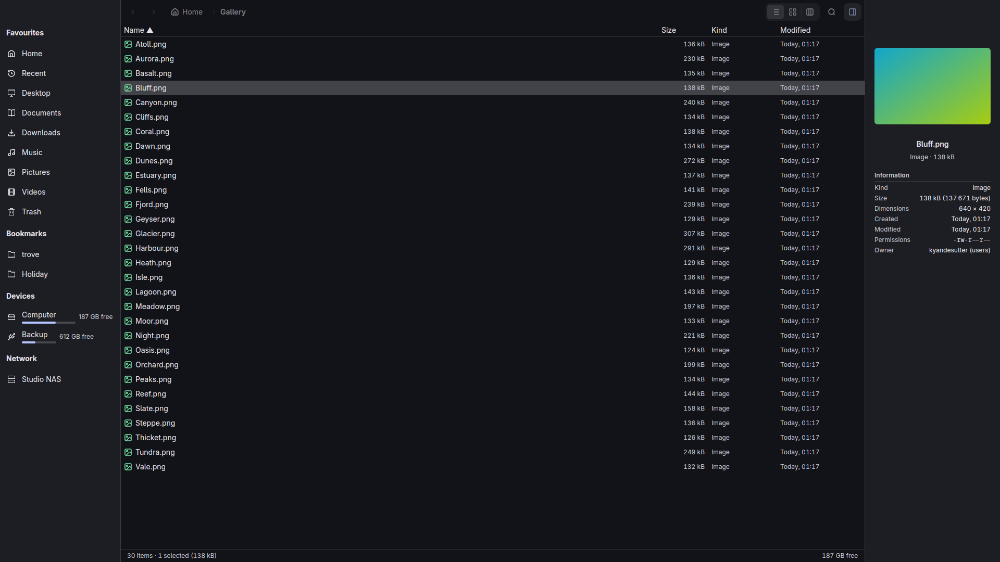

<p align="center">
  
</p>

# Trove

[](https://github.com/FormalStudio/NativeDesktop)
[](src/)

A file manager for Linux that opens instantly, even with a dead network mount in the sidebar.



A release build reaches its first frame about 148 ms after the process starts (g815, private
headless Hyprland, median of ten launches, `tests/real.rs`). Each tab streams its folder from
worker threads: names land first, sizes and dates fill in as they are read, and leaving a folder
drops its listing instead of waiting for it. The first frame waits on nothing but a few small
config files, so a mount that never answers cannot hold the window back.

## Features

- Tabs with their own history, folder, selection, sort and view: Ctrl+T, Ctrl+W, Ctrl+Tab, Ctrl+1..9.
- List, grid and columns views. Thumbnails are made off the main thread.
- Search from the second character, across the folder or all of Home, with a query language:
  `ext:pdf`, `kind:image`, `size:>10mb`, `modified:week`, `in:projects`, `"exact phrase"`,
  `*.rs` globs. Ranked results update per keystroke from a background index of Home.
- A preview pane (Ctrl+I) for pictures, text, folders, archives and audio, and Quick Look on Space.
- Network mounts are never touched until clicked. A folder that is slow to answer says "Waiting
  for server" after one second and the window stays responsive.
- Copy, move, rename, trash, restore, compress and extract run as queued jobs with progress,
  conflict handling and undo.
- Interop with the rest of the desktop: the freedesktop Trash, the shared thumbnail cache, GTK
  bookmarks, `recently-used.xbel`, and the GNOME Files clipboard format.
- Follows the system: light and dark, the accent colour, and matugen palettes, live.
- Writes an incident bundle when it crashes or hangs, with the last inputs and what was on screen.

## Install

### Linux

Needs Rust 1.95 (pinned by `rust-toolchain.toml`) and, to build, `libxkbcommon`, `wayland`,
`vulkan-loader`, `fontconfig`, `freetype`, `alsa-lib`.

```sh
git clone https://github.com/FormalStudio/trove
cd trove
fspec dev -- cargo build --release     # or plain `cargo build --release` where it links
install -Dm755 target/release/trove ~/.local/bin/trove
install -Dm644 packaging/linux/dev.formalsnake.trove.desktop ~/.local/share/applications/dev.formalsnake.trove.desktop
install -Dm644 packaging/linux/dev.formalsnake.trove.png ~/.local/share/icons/hicolor/512x512/apps/dev.formalsnake.trove.png
```

`trove %U` takes paths and `file://` URIs, so the desktop entry can be the default handler for
`inode/directory`: `xdg-mime default dev.formalsnake.trove.desktop inode/directory`.

`nd package linux` builds an AppImage into `target/nd/`. macOS (`nd package mac`) and Windows
(`nd package windows`) builds come from the same source and are not published yet.

## Configuration

Preferences live in `~/.config/trove/config.toml`, or per key as `TROVE_<KEY>`:

```toml
show_hidden = false
folders_first = true
default_view = "list"     # or "grid"
single_click = false
confirm_trash = false
network_thumbnails = false
```

| Variable | Effect |
| --- | --- |
| `TROVE_DEMO=1` | start on fixed demo state |
| `TROVE_TRACE=1` | print milestones from process start to the first frame |

## Keyboard

The full table is in [docs/design.md](docs/design.md#keys). The ones to know: Enter opens,
Backspace goes up, Space is Quick Look, F2 renames, Ctrl+F searches, Ctrl+L edits the path,
Ctrl+H shows hidden files, Ctrl+1/2/3 switch view. `Cmd` replaces `Ctrl` on macOS.

## Development

```sh
just dev                  # run it; TROVE_DEMO=1 just dev for demo state
nd check                  # fmt, clippy, framework lints, appearance audit
nd test                   # tiers 1 and 2, parallel, no window
nd test --tier real       # tier 3, real windows
scripts/shots linux       # regenerate docs/shots/linux.png
```

`src/root.rs` is the window and `src/tab.rs` one tab. `crates/` holds the file system, operations,
preview and search code, none of which depends on the UI. `docs/design.md` has the budgets and
contracts, and `CLAUDE.md` and `docs/agents/` the rules for agents working here.

## License

[MIT](LICENSE).
