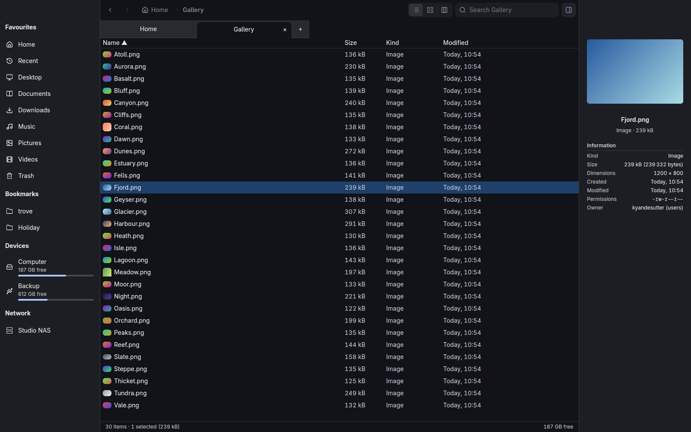
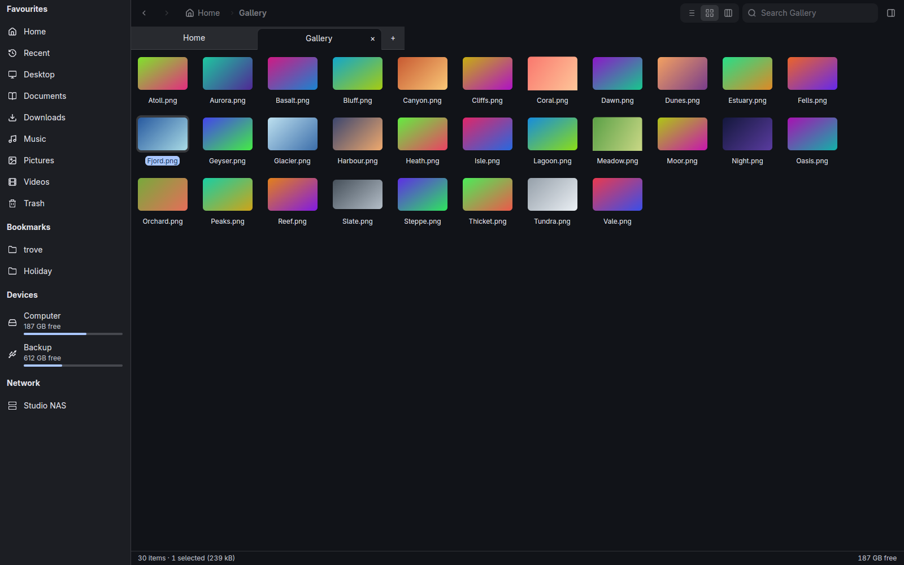
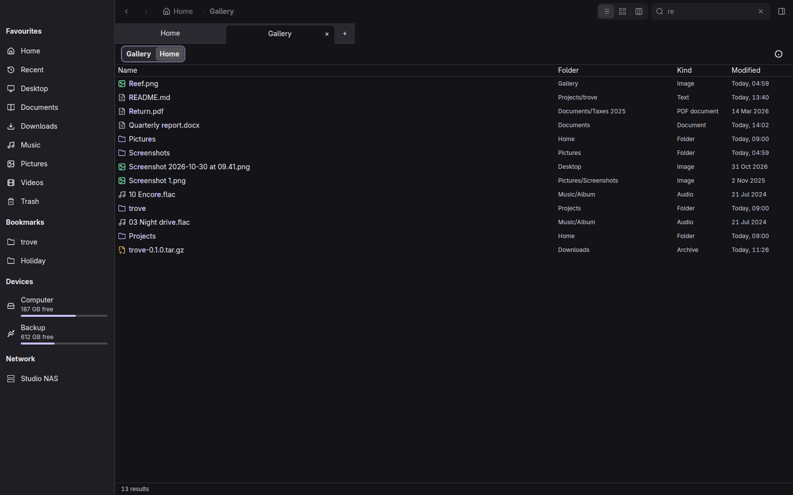
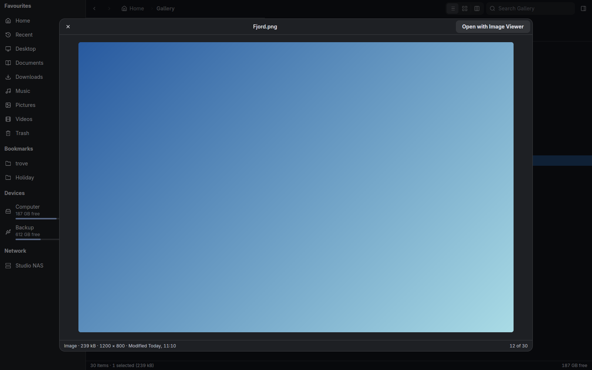
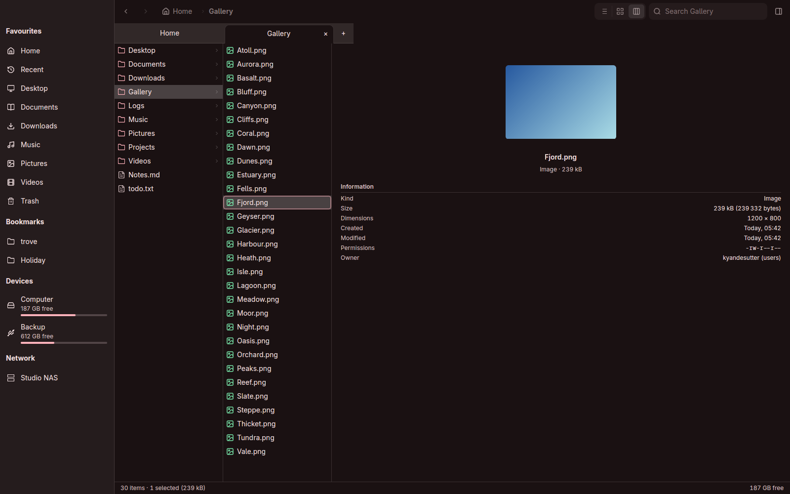

<p align="center"></p>

# Trove

A file manager for Linux that opens at once, even with a dead network mount in the sidebar.
Rust on [NativeDesktop](https://github.com/FormalStudio/NativeDesktop) (GPUI on Linux), with
tabs, three views, a preview pane, Quick Look and search across Home.



```
┌────────────────────────┐  flume   ┌───────────────────────────────────────────────┐
│ trove (nd, GPUI)       │ ───────▶ │ trove-fs       listing threads, inotify       │
│ window, tabs, sidebar, │          │ trove-ops      the operation queue            │
│ views, preview pane    │ ◀─────── │ trove-preview  previews, thumbnail pool       │
└────────────────────────┘          │ trove-search   index of Home, query engine    │
                                    └───────────────────────────────────────────────┘
```

The window thread never touches the disk: listings, stats, previews, thumbnails, copies and
search run on the core crates' own threads and report back over channels. Pinned to g815's
E-cores, a release build reaches its first frame in 178 ms whatever is mounted, shows the first
names of a 100k-entry folder 10 ms after you enter it, and ranks search results across 343k
entries in 0.4 to 2.4 ms per keystroke. Left alone it used at most one 10 ms tick of CPU in a
minute, focused or behind another window.

| | |
|---|---|
|  |  |
|  |  |

## Features

- Tabs with their own history, folder, selection, sort and view: Ctrl+T, Ctrl+W, Ctrl+Tab,
  Alt+1..9. Middle-click a folder to open it in a tab, or a tab to close it.
- List, grid and columns views. Thumbnails are made off the main thread.
- Search from the second character, across the folder or all of Home, with a query language:
  `ext:pdf`, `kind:image`, `size:>10mb`, `modified:week`, `in:projects`, `"exact phrase"`,
  `*.rs` globs. Ranked results update per keystroke from a background index of Home.
- A preview pane (Ctrl+I) for pictures, text, folders, archives and audio, and Quick Look on Space.
- A sidebar of places, bookmarks and devices with their free space, each row with its own menu.
  The sidebar and the preview pane resize, and keep their widths.
- Network mounts are never touched until clicked. A folder that is slow to answer says "Waiting
  for server" after one second and the window stays responsive.
- Copy, move, rename, trash, restore, compress and extract run as queued jobs with progress,
  conflict handling and undo. Hold Ctrl while dragging to copy, Shift to move.
- Interop with the rest of the desktop: the freedesktop Trash, the shared thumbnail cache, GTK
  bookmarks, `recently-used.xbel`, and the GNOME Files clipboard format.
- Follows the system: light and dark, the accent colour, and matugen palettes, live.
- Writes an incident bundle when it crashes or hangs, with the last inputs and what was on screen.

## Install

### Linux

Needs Rust 1.95 (pinned by `rust-toolchain.toml`) and, to build, `libxkbcommon`, `wayland`,
`vulkan-loader`, `fontconfig`, `freetype`, `alsa-lib`.

```sh
git clone https://github.com/FormalStudio/trove
cd trove
fspec dev -- cargo build --release     # or plain `cargo build --release` where it links
install -Dm755 target/release/trove ~/.local/bin/trove
install -Dm644 packaging/linux/dev.formalsnake.trove.desktop ~/.local/share/applications/dev.formalsnake.trove.desktop
install -Dm644 packaging/linux/dev.formalsnake.trove.png ~/.local/share/icons/hicolor/512x512/apps/dev.formalsnake.trove.png
```

`trove %U` takes paths and `file://` URIs, so the desktop entry can be the default handler for
`inode/directory`: `xdg-mime default dev.formalsnake.trove.desktop inode/directory`.

### As the system file chooser

`trove --portal` is a D-Bus service: xdg-desktop-portal's FileChooser backend, so apps' Open
and Save dialogs open a Trove window, and `org.freedesktop.FileManager1`, so "Show in folder"
in a browser opens Trove with the file selected. D-Bus starts it on demand. To install it next
to the binary above:

```sh
mkdir -p ~/.local/share/dbus-1/services
for name in org.freedesktop.impl.portal.desktop.trove org.freedesktop.FileManager1; do
  sed "s|/usr/bin/trove|$HOME/.local/bin/trove|" packaging/linux/$name.service \
    > ~/.local/share/dbus-1/services/$name.service
done
install -Dm644 packaging/linux/trove.portal ~/.local/share/xdg-desktop-portal/portals/trove.portal
```

Then pick it for file choosing under `[preferred]` in your desktop's portals config (for
Hyprland, `~/.config/xdg-desktop-portal/hyprland-portals.conf`, keeping its `default=` line):
`org.freedesktop.impl.portal.FileChooser=trove`. xdg-desktop-portal reads its config when it
starts, so log out and back in (or `systemctl --user restart xdg-desktop-portal`).

`nd package linux` builds an AppImage into `target/nd/`. macOS (`nd package mac`) and Windows
(`nd package windows`) builds come from the same source and are not published yet.

## Configuration

Preferences live in `~/.config/trove/config.toml`, or per key as `TROVE_<KEY>`:

```toml
show_hidden = false
folders_first = true
default_view = "list"     # or "grid"
single_click = false
confirm_trash = false
network_thumbnails = false
```

| Variable | Effect |
| --- | --- |
| `TROVE_DEMO=1` | start on fixed demo state |
| `TROVE_TRACE=1` | print milestones from process start to the first frame |

## Keyboard

The full table is in [docs/design.md](docs/design.md#keys). The ones to know: Enter opens,
Backspace goes up, Space is Quick Look, F2 renames, Ctrl+F searches, Ctrl+L edits the path,
Ctrl+H shows hidden files, Ctrl+1/2/3 switch view, Alt+1..9 switch tab. `Cmd` replaces `Ctrl`
on macOS.

## Development

```sh
just dev                  # run it; TROVE_DEMO=1 just dev for demo state
nd check                  # fmt, clippy, framework lints, appearance audit
nd test                   # tiers 1 and 2, parallel, no window
nd test --tier real       # tier 3, real windows
scripts/shots linux       # regenerate docs/images/ and docs/shots/linux.png
```

`src/root.rs` is the window and `src/tab.rs` one tab. `crates/` holds the file system, operations,
preview and search code, none of which depends on the UI. `docs/design.md` has the budgets and
contracts, and `CLAUDE.md` and `docs/agents/` the rules for agents working here.

## License

[MIT](LICENSE).
